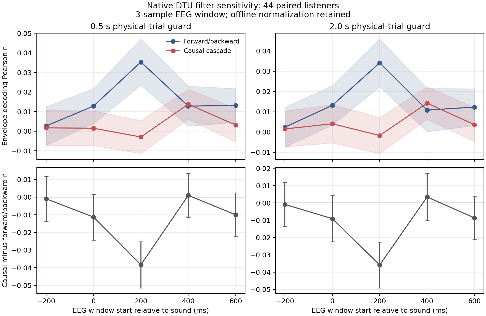

# Native DTU filter and boundary sensitivity

Complete:10/10fold tasks,44/44 paired listeners. Numerical snapshot 2026-10-17T18:09:52.072463+02:00; report rendered 2026-10-17T18:10:07.195002+02:00.

The new native-BDF pipelines use two forward Butterworth passes or forward/backward filtering with the same interior magnitude response. No causal filter delay is compensated. Both retain the original sound envelope and offline whole-recording channel normalization. Thus this is a filter/boundary sensitivity, not an online-causal pipeline, a neural latency measurement, or a test of the absence of auditory information. The3-sample EEG window is23.4375ms at128Hz. Five person folds and two content folds do not increase the independent sample size.

All10guard×lag cells are reported. Means first combine the two content folds within each identity.4000identity bootstrap-t intervals are simultaneous across the10cells within each metric/contrast family; separate model-level bands and difference bands are not interchangeable. Positive r benefit means causal minus forward/backward correlation. Positive MSE benefit means forward/backward minus causal loss, in the original envelope-squared units. No test-selected time, group, model or sign is substituted.

| Guard / lag(ms) | Forward/backward r | Causal r | Paired difference | Simultaneous95% interval |
|---|---:|---:|---:|---|
| 0.5/-200 | 0.00266 | 0.00171 | -0.00095 | [-0.01370, +0.01179] |
| 0.5/0 | 0.01282 | 0.00150 | -0.01131 | [-0.02431, +0.00169] |
| 0.5/200 | 0.03534 | -0.00298 | -0.03832 | [-0.05139, -0.02526] |
| 0.5/400 | 0.01280 | 0.01380 | +0.00100 | [-0.01148, +0.01349] |
| 0.5/600 | 0.01315 | 0.00313 | -0.01002 | [-0.02239, +0.00234] |
| 2.0/-200 | 0.00242 | 0.00153 | -0.00089 | [-0.01374, +0.01197] |
| 2.0/0 | 0.01316 | 0.00406 | -0.00909 | [-0.02246, +0.00427] |
| 2.0/200 | 0.03415 | -0.00170 | -0.03584 | [-0.04907, -0.02262] |
| 2.0/400 | 0.01083 | 0.01426 | +0.00343 | [-0.01024, +0.01710] |
| 2.0/600 | 0.01230 | 0.00363 | -0.00868 | [-0.02123, +0.00387] |

| Guard / lag(ms) | MSE benefit | Simultaneous95% interval |
|---|---:|---|
| 0.5/-200 | -2.0582e-10 | [-6.8378e-10, +2.7214e-10] |
| 0.5/0 | -5.8262e-10 | [-1.1330e-09, -3.2191e-11] |
| 0.5/200 | -9.7726e-10 | [-1.3496e-09, -6.0492e-10] |
| 0.5/400 | +5.4571e-10 | [-2.6240e-11, +1.1177e-09] |
| 0.5/600 | -9.8048e-10 | [-1.4933e-09, -4.6765e-10] |
| 2.0/-200 | -2.5961e-10 | [-7.7763e-10, +2.5840e-10] |
| 2.0/0 | -5.2497e-10 | [-1.0772e-09, +2.7235e-11] |
| 2.0/200 | -1.0577e-09 | [-1.4836e-09, -6.3183e-10] |
| 2.0/400 | +5.7109e-10 | [+1.1007e-11, +1.1312e-09] |
| 2.0/600 | -7.8296e-10 | [-1.1844e-09, -3.8158e-10] |

| Guard / lag(ms) | HI minus NH difference in r intervention effect | Simultaneous95% interval |
|---|---:|---|
| 0.5/-200 | +0.00291 | [-0.02346, +0.02928] |
| 0.5/0 | -0.00386 | [-0.03074, +0.02303] |
| 0.5/200 | -0.02362 | [-0.04859, +0.00135] |
| 0.5/400 | -0.00780 | [-0.03343, +0.01784] |
| 0.5/600 | +0.00751 | [-0.01790, +0.03291] |
| 2.0/-200 | +0.00158 | [-0.02504, +0.02820] |
| 2.0/0 | +0.00146 | [-0.02623, +0.02915] |
| 2.0/200 | -0.02501 | [-0.05007, +0.00006] |
| 2.0/400 | -0.00805 | [-0.03616, +0.02006] |
| 2.0/600 | +0.00639 | [-0.01947, +0.03224] |

The full JSON also retains each hearing group and both model-level families. A crossing-zero interval is uncertainty about this declared contrast, not equivalence. Changes at fixed lags may reflect the causal filter phase/delay and boundary treatment; they cannot isolate a neural source or turn positive-minus-negative decoding into pure neural information.

Rendering provenance: the frozen experiment and numerical JSON are unchanged. The first report rounded native MSE differences to five decimals; this version uses scientific notation and adds levels, the direct group interaction and a figure. Original rendering retained under the private ALN3.4 directory.
Numerical JSON SHA256 `66d4fad5f68aec749cc8fc619426fddfc84de09c6ae78d167d35e1c73b6adb2d`; plan SHA256 `05ca59fa05f8ecb1dcaf1a692bdf2dc945ac2916e348170b7df609ee349fe28c`; rendering job `1044351`.
